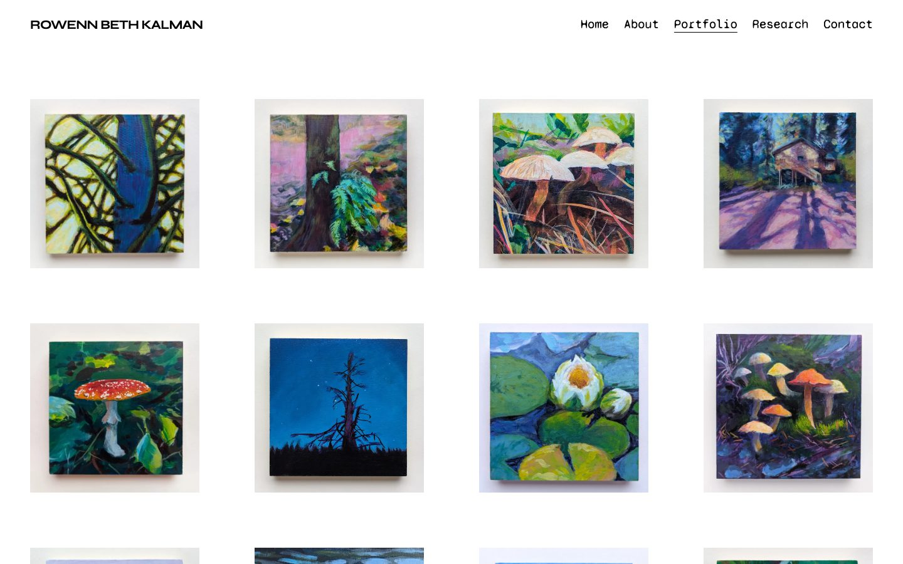

# Rowenn Beth Kalman

The website of Rowenn Beth Kalman, painter: her portfolio, her doctoral research on
environmental awareness, and a way to get in touch. Live at
[rowennkalman.com](https://rowennkalman.com).



## On the site

- **Portfolio.** Every painting with its title and details; click one to see it large and
  page through the rest.
- **About** and **Contact**, with a contact form that emails Rowenn directly.
- **Research.** Her PhD thesis and its bilingual book, readable as PDFs.

## How Rowenn edits it

Everything on the site is edited at `/admin`. She signs in with a link sent to her email; there
is no password. She can change any text, add, reorder and remove paintings, and upload new
photos, which the site resizes on upload. A save goes live within seconds, and if the page
changed in another tab since she opened it, the admin says so instead of overwriting it.

## How it is built

Next.js (App Router) with React 19 and TypeScript, hosted on Netlify. There is no database: the
content is one JSON file and the pictures are files, both in a Scaleway Object Storage bucket.
Pictures are served in ready-made sizes through a Cloudflare Worker at `img.rowennkalman.com`.
Mail goes out through [Resend](https://resend.com); visits are counted by a self-hosted
GoatCounter.

## Running it locally

```sh
npm ci
npm run dev        # http://localhost:3000, content in .data/
npm test           # unit tests
npm run e2e        # browser tests, on a scratch store
```

Without the bucket settings the site reads and writes a local store in `.data/`; without the
mail key, sign-in links are printed to the terminal instead of emailed. The settings it understands are listed by name
in `.env.example`. If your `.env.local` holds the real bucket settings, `npm run dev` edits the
live site.

## Maintenance

| Task | How |
|---|---|
| Deploy | push to `master` (Netlify builds it; `netlify.toml` holds the setup) |
| Code quality | `npm run sonar` (SonarQube; commit first) |
| Netlify from the terminal | `scripts/netlify.sh <netlify-cli args>` |
| Picture sizes (backfill or repair) | `npm run image-sizes` (dry run), then `-- --apply` |
| Failed uploads | `npm run upload-failures [-- --since 7d]` |
| Image Worker | `scripts/cloudflare.sh deploy \| tail \| purge <url>` |

Public pages are cached for an hour and purged on every save; each page's
`<meta name="content-version">` shows which save it is showing. Secrets live in Netlify and the
macOS Keychain, never in the repository.

## Docs

- [`docs/PLAN.md`](docs/PLAN.md): status, decisions, caching, SEO, and what is deferred.
- [`docs/IMAGES.md`](docs/IMAGES.md): the picture pipeline, its switches and runbooks.
- [`docs/AUDIT.md`](docs/AUDIT.md): audits and incidents, and how each was resolved.
- [`docs/admin-REPORT.md`](docs/admin-REPORT.md): the original admin and backend report.

## Copyright

The paintings, photographs and texts are © Rowenn Beth Kalman, all rights reserved.
